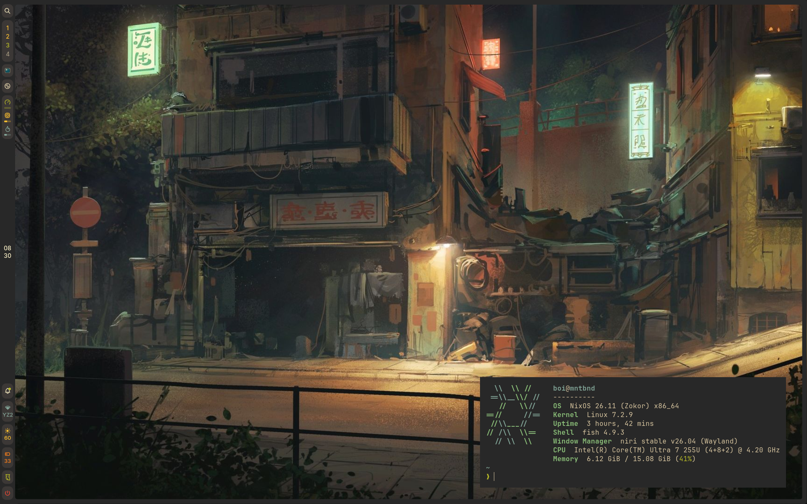

<div align="center">



# nixdots

**A flake-based NixOS + Home Manager setup for one laptop, built around niri and Gruvbox.**

<br />

[](https://nixos.org)
[](https://github.com/YaLTeR/niri)
[](https://github.com/nix-community/home-manager)
[](https://github.com/morhetz/gruvbox)
<br />
[](.github/workflows/lint.yml)
[](https://github.com/Yasir-Zafar/nixdots/commits/main)
[](https://github.com/Yasir-Zafar/nixdots)

[Overview](#overview) · [Layout](#layout) · [Install](#install) · [nx](#nx) · [Greeters](#greeters) · [Usage guide](docs/USAGE.md) · [Apps](docs/APPS.md) · [Preferences](docs/PREFERENCES.md) · [Credits](#credits)

</div>

---

## Overview

| | |
| --- | --- |
| **OS** | NixOS `nixos-unstable`, latest kernel, systemd-boot |
| **Compositor** | [niri](https://github.com/YaLTeR/niri) (scrollable tiling, Wayland) |
| **Shell / bar** | [Noctalia](https://github.com/noctalia-dev/noctalia) |
| **Greeter** | [sysc-greet](https://github.com/Nomadcxx/sysc-greet) on greetd, Gruvbox + ASCII rain |
| **Terminal** | Ghostty, starship prompt, zellij, atuin, lazygit, yazi, fastfetch |
| **Shells** | fish (interactive, in Ghostty), zsh (login), bash |
| **Editor** | Neovim via [nixvim](https://github.com/nix-community/nixvim) (kickstart-style, nightly), plus VS Code, Cursor, Antigravity and JetBrains |
| **Theming** | [Stylix](https://github.com/nix-community/stylix) with `gruvbox-dark-medium`, opt-in per target |
| **Fonts** | JetBrainsMono Nerd Font, Inter, Source Serif Pro |
| **GTK / icons / cursor** | Gruvbox-Green-Dark, Gruvbox-Plus-Dark, Bibata Modern Classic |
| **Browser** | [Zen](https://github.com/0xc000022070/zen-browser-flake), through its home-manager module (policies + extensions declared) |
| **Gaming** | Steam + Proton-GE ([Millennium](https://github.com/SteamClientHomebrew/Millennium) wired up, currently off), Heroic, Prism Launcher, Dolphin, Sober (flatpak via [nix-flatpak](https://github.com/gmodena/nix-flatpak)), gamemode, MangoHud, ntsync |
| **Discord** | Vencord via [nixcord](https://github.com/FlameFlag/nixcord) |
| **Hardware** | HP OmniBook 5 16", Intel Core Ultra 7 255U, Intel graphics |

## Layout

The system and the user environment are **two independent flakes** with their own lock files, so a broken home config never blocks a system rebuild and the other way round. The flakes themselves are tiny; the modules they load live in the shared tree next to them.

```text
dots/
├── nix/                  NixOS flake         ->  nixosConfigurations.mntbnd (+ devshell templates)
│   └── flake.nix, flake.lock
├── hm/                   Home Manager flake  ->  homeConfigurations.boi
│   └── flake.nix, flake.lock
├── hosts/mntbnd/         the machine: hardware-configuration.nix, stateVersion
├── home/boi.nix          the user: username, home dir, stateVersion
├── modules/
│   ├── nixos/            system modules
│   │   ├── nix.nix        nix settings, gc, store optimise
│   │   ├── boot/          systemd-boot, kernel params (documented, test-first)
│   │   ├── hardware/      Intel graphics, swap, firmware
│   │   ├── desktop/       niri, fonts, greeters/ (sysc-greet active + alternates), gnome
│   │   ├── services/      audio, bluetooth, networking, power, syncthing
│   │   ├── gaming/        steam, gamemode, launchers, emulators
│   │   ├── development/   system-level toolchains, docker
│   │   ├── security/
│   │   └── users/
│   └── home/             home-manager modules
│       ├── desktop/       niri config, noctalia, stylix, gtk/qt, gnome settings
│       ├── terminal/      ghostty, shells + aliases, prompt, tools
│       ├── development/   editors, languages, git
│       ├── applications/  media, documents, network, utilities, nixcord
│       └── nixvim/        Neovim, written in Nix
├── pkgs/nx/              the nx CLI: nx.sh + completions
├── lib/default.nix       values both flakes share (user, host, emails, assets)
├── templates/            per-project dev shells (rust, python, node, c)
├── assets/               wallpaper, avatar, GTK and icon themes
├── docs/                 usage guide, what every app is for, preferences
└── statix.toml           lint ignores
```

Every directory has a `default.nix` that only imports its siblings. To turn something off, comment out one import line.

## Install

> [!WARNING]
> This is a personal config. The user `boi`, the host `mntbnd` and the addresses are set once in [`lib/default.nix`](lib/default.nix), and `hosts/mntbnd/` holds this laptop's `hardware-configuration.nix`. Read it and borrow pieces rather than applying it blind.

```sh
# 1. clone to ~/dots (nx expects that path; override with NX_DOTS)
git clone https://github.com/Yasir-Zafar/nixdots ~/dots
cd ~/dots

# 2. swap in your own hardware config
nixos-generate-config --show-hardware-config > hosts/mntbnd/hardware-configuration.nix

# 3. build the system, then the home
sudo nixos-rebuild switch --flake ./nix#mntbnd
nix run home-manager -- switch --flake ./hm#boi
```

After the first switch, everything goes through `nx`. The full guide (everyday loop, every `nx` command, common tasks, recovery, key binds) is in [docs/USAGE.md](docs/USAGE.md); every installed app and what it is for is in [docs/APPS.md](docs/APPS.md); what to keep and what not to change is in [docs/PREFERENCES.md](docs/PREFERENCES.md).

## nx

`nx` is one command for the whole update lifecycle. It lives in [`pkgs/nx/`](pkgs/nx/) (plain bash in `nx.sh`), wraps [`nh`](https://github.com/nix-community/nh), and ships zsh and fish completions.

| Command | What it does |
| --- | --- |
| `nx update [input…]` | update both `flake.lock`s, all inputs or only the ones named |
| `nx os [switch\|boot\|test\|build]` | rebuild the system |
| `nx home [switch\|build] [-b]` | rebuild the home, `-b` backs up conflicting files |
| `nx all` | update, then switch system, then switch home |
| `nx build` | build both without activating anything |
| `nx diff` | package changes since boot (`nvd`) |
| `nx status` | lock ages, nixpkgs revisions, git state, disk |
| `nx doctor` | checks env vars, stray flakes, failed units, core dumps, `.bak` files, pending reboot, nixpkgs drift between the two flakes |
| `nx rollback [os\|home] [N]` | list generations or go back |
| `nx clean` / `nx optimise` | garbage-collect (keep 7 days / 5 gens) and dedupe the store |
| `nx storage [report\|clean] [--hard]` | show what's eating disk and clear only caches that rebuild themselves; `--hard` also drops the nix fetch cache, unused docker images and every old generation |
| `nx firmware [check\|update\|…]` | firmware updates through fwupd / LVFS |
| `nx try <greeter>` | boot-test another greeter (see below) |
| `nx lint` / `nx fmt` | statix + deadnix, and alejandra |

## Greeters

Every greeter has its own problems, so the alternatives stay in the repo next to the active one:

| Variant | File |
| --- | --- |
| **sysc-greet** (active) | [`greeters/sysc-greet.nix`](modules/nixos/desktop/greeters/sysc-greet.nix) |
| tuigreet | [`greeters/tuigreet.nix`](modules/nixos/desktop/greeters/tuigreet.nix) |
| LightDM | [`greeters/lightdm.nix`](modules/nixos/desktop/greeters/lightdm.nix) |
| GDM | [`greeters/gdm.nix`](modules/nixos/desktop/greeters/gdm.nix) |
| ly | [`greeters/ly.nix`](modules/nixos/desktop/greeters/ly.nix) |

What every greeter shares (desktop services, avatar, gnome utility apps, xdg dirs) is in [`greeters/common.nix`](modules/nixos/desktop/greeters/common.nix). The active one is picked by a single import line in [`modules/nixos/desktop/default.nix`](modules/nixos/desktop/default.nix).

`nx try lightdm` swaps that line, builds, and with your OK makes that variant the default boot entry. It restores `desktop/default.nix` afterwards and never touches the running session. Go back with `nx os boot`.

## Development

```sh
nix develop ./nix   # alejandra, statix, deadnix, nh
nx fmt && nx lint
```

New projects get their toolchain from a template instead of the global profile:

```sh
nix flake init -t ~/dots/nix#rust   # or python, node, c
direnv allow
```

CI runs the same statix, deadnix and alejandra checks on every push and pull request.

## Credits

- [niri](https://github.com/YaLTeR/niri) and [niri-flake](https://github.com/epireyn/niri-flake) (epireyn's fork of sodiboo's)
- [Noctalia](https://github.com/noctalia-dev/noctalia)
- [sysc-greet](https://github.com/Nomadcxx/sysc-greet)
- [Stylix](https://github.com/nix-community/stylix), [nixvim](https://github.com/nix-community/nixvim), [nixcord](https://github.com/FlameFlag/nixcord), [nh](https://github.com/nix-community/nh)
- [zen-browser-flake](https://github.com/0xc000022070/zen-browser-flake), [claude-code-nix](https://github.com/sadjow/claude-code-nix), [nix-flatpak](https://github.com/gmodena/nix-flatpak), [nix-index-database](https://github.com/nix-community/nix-index-database)
- [Gruvbox Plus icons](https://github.com/SylEleuth/gruvbox-plus-icon-pack) and [Gruvbox GTK theme](https://github.com/Fausto-Korpsvart/Gruvbox-GTK-Theme)

<div align="center">
<br />
<sub>made with ❄️ and too many rebuilds</sub>
</div>
